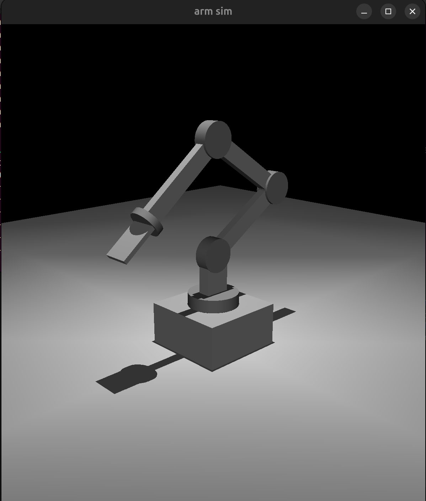

# Robot Arm Simulation + ROS Noetic Implementation

## Implementasi ROS

### Untuk implementasi ROS dasar menggunakan topic.
simulation.cpp kirim data ctrl mjData dan state robot, monitor.cpp olah data jadi string yang rapih & gampang dibaca, dan juga format data posisi.

Simulasi sekarang menggunakan:
```
rosrun arm_sim start
```
Untuk track current position dan state, pakai:
```
rosrun arm_sim monitor
```
Kedua command diatas publish & subscribe dari topic: botdata_topic


### Untuk pergerakan segitiga menggunakan service.
triangle.cpp ketika di run mengirim sinyal ke simulation.cpp untuk ganti posisi robot tiap n detik

Pertama, run simulasi dengan:
```
rosrun arm_sim start
```
Kemudian, run:
```
rosrun arm_sim triangle
```
Saat ganti state (pencet key teleop/pose), rosrun triangle berhenti.

## Apa nih

Program untuk simulasi robot arm dari file .xml dan pergerakkannya dengan input, menggunakan Mujoco dan GLFW3.

Program dibagi jadi beberapa file utama:
1. simulation.cpp: file yang run simulasi, termasuk loop simulasi
2. simulation.hpp: include library yang dibutuhkan untuksimulasi dan variable awal simulasi
3. arm.urdf: file .urdf robot arm
4. arm.xml: file .xml robot arm
5. controls.hpp: file berisi fungsi untuk pergerakkan robot
6. callback.hpp: file berisi callback input saat simulasi run
7. CMakelists.txt: file cmake untuk build program

## Control System
Robot arm ini memiliki 4 joint: 
| Joint | Axis | Connection | Range |
| :--- | :--- | :--- | :---: |
| Torso | Z (Yaw) | Base to Torso | -180 to 180 |
| Shoulder | Y (Pitch) | Torso to Shoulder | -120° to 120° |
| Upper arm | Y (Pitch) | Shoulder to Upper arm | -120° to 120° |
| Forearm | Y (Pitch) | Upper arm to Forearm | -120° to 120° |
| Hand | Z (Yaw) | Forearm to Hand | -180 to 180 |

### Key Binds
#### Joints
| Joint | Left | Right |
| :--- | :---: | :---: |
| Torso | N | M |
| Shoulder | Z | X |
| Upper Arm | A | S |
| Forearm | Q | W |
| Hand | J | K |

#### Poses

Pose bisa dibuat dengan function addPose() dalam file poses.cpp dengan syntax:
```
addPose(PoseList, "Name", GLFW_KEY_(key), {int, int, int, int, int});
```

Pose yang sudah dibuat:

| Pose | Key |
| :--- | :---: |
| Default | Space |
| Zig Zag | C |
| Straight Up | V |
| Max Length | B |

## Documentation
[Google Drive KPP 2 (Arm Simulation) Internship Abinara-1](https://drive.google.com/drive/folders/1mgvDs7uPf0qPjJeyyshWKm6b_AfDDRkG?usp=sharing)

[Google Drive KPP 3 (ROS Implementation) Internship Abinara-1](https://drive.google.com/drive/folders/1m7CkMru5FVrv4WDvlpoct-vIPxlMVlHj?usp=sharing)

### Screenshots
